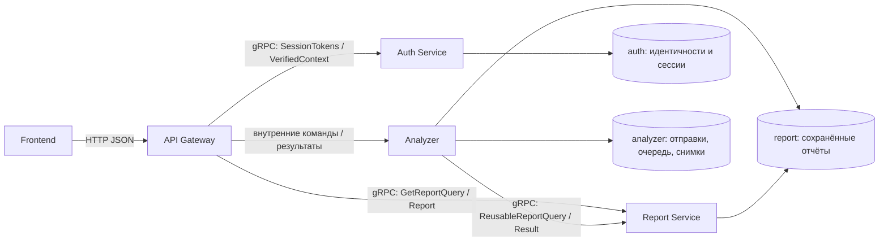
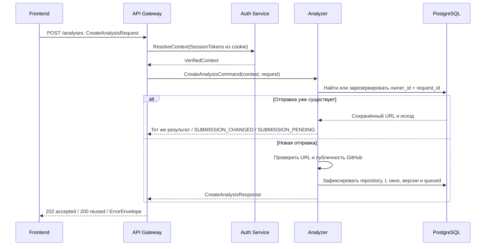
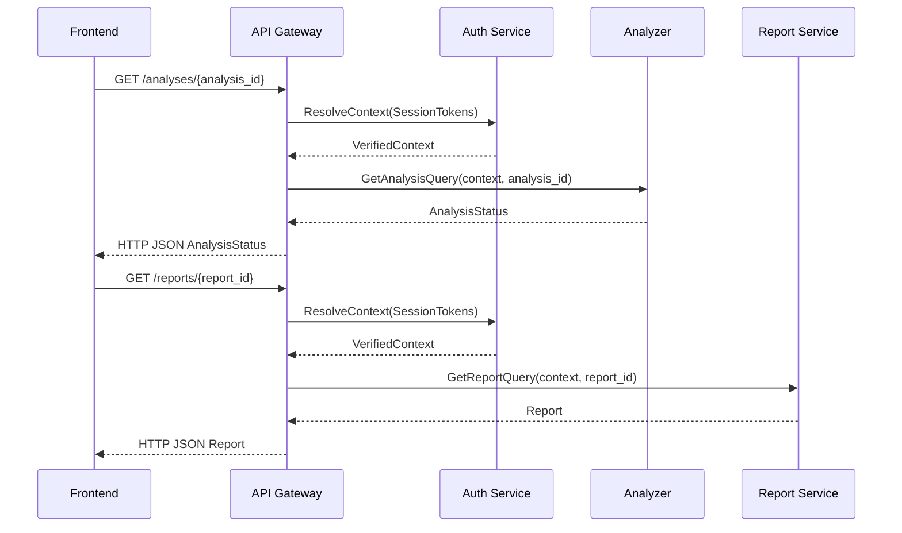

# Движение данных RepoPulse по контрактам

Основа: [архитектура №916](https://ai.nsu.ru/documents/916),
[описание контрактов](../../contracts/README.md),
[HTTP операции](../../contracts/gateway/README.md),
[поля JSON и gRPC](../field-map.md).
Это целевой flow MVP. В С1 подключены гостевой Auth и HTTP-проверка репозитория.
В #18476 реализованы очередь Analyzer и безопасное чтение Git; #18479 собирает
и передаёт на сохранение безопасные нормализованные входы. HTTP-запуск/статус,
коллекторы отдельных метрик и расчёт подключаются отдельными задачами; готовность частей
исполнителя описана [отдельно](analyzer-execution.md).

## Границы и представления



Хранилища на диаграмме — схемы одной PostgreSQL. Gateway проверяет HTTP,
получает проверенный контекст и переносит поля между HTTP DTO и внутренними
сообщениями. Auth и Report имеют сетевые gRPC-контракты. Analyzer — компонент
backend; ValidateRepository/CreateAnalysis/GetAnalysis описаны как внутренние
операции, отдельный сетевой RPC для них не объявлен.

## Сессии и владелец

| Действие | Данные и вызов | Что получает браузер |
|---|---|---|
| Регистрация | Credentials → Auth.Register → RegistrationResult | Подтверждение создания; вход выполняется отдельно |
| Вход | Credentials → Auth.Login → IssuedSession | SessionInfo; token из IssuedSession устанавливается account cookie |
| Продолжение гостем | Проверка guest cookie через GetSessionContext; при отсутствии действующего гостя Auth.CreateGuestSession(Empty) → IssuedSession | SessionInfo и guest cookie; действующая гостевая сессия не продлевается |
| Сведения для UI | Cookie → SessionTokens → Auth.GetSessionContext → SessionContext | account/guest с kind/login/expires_at либо null; токены и ID не возвращаются |
| Проверка контекста | Cookie → SessionTokens → Auth.ResolveContext → VerifiedContext | Gateway использует только проверенные идентичности и сроки |
| Выход | Текущая account cookie → LogoutCommand.account_token → Auth.Logout → Empty | 204 и удаление account cookie; независимые сессии и guest сохраняются |

VerifiedContext может содержать и user_id, и guest_session_id. На новом запуске
Owner выбирается один раз: действующий аккаунт имеет приоритет, иначе исходный
действующий гость. Owner.id — серверный principal_id, не GitHub owner и не токен.
Owner сохраняется в submissions/analyses/snapshot/report и не меняется после входа.

Для чтения Report проверяется соответствие сохранённого Owner одному из
действующих контекстов. Гостевой отчёт доступен исходному гостю и после входа
при сохранённой guest cookie, но не переносится в историю аккаунта. Истёкшая
предъявленная account cookie не приводит к незаметному гостевому запуску:
возвращается ошибка сессии, продолжение гостем — отдельное действие пользователя.

Для GET /auth/session добавлен отдельный RPC GetSessionContext(SessionTokens).
Gateway явно преобразует SessionInfo в HTTP DTO и не читает БД Auth.
В С1 Auth возвращает сведения о гостевой сессии; аккаунтные сценарии ещё не
реализованы. Отсутствующие, истёкшие и отозванные guest cookie дают guest=null.
GET без действующих сессий возвращает 200 с account=null и guest=null.
Предъявленная account cookie без подтверждения Auth даёт 401 SESSION_EXPIRED,
даже при действующем госте. Frontend не перехватывает эту ошибку для смены владельца.

При пустом контексте frontend создаёт гостя через POST /auth/guest-session и
повторным GET подтверждает сохранность cookie перед запросом валидации.
POST повторно использует действующего гостя: тот же токен и первоначальный срок,
ответ 200 вместо 201. Cookie HttpOnly, SameSite=Lax, Path=/api/v1, без Max-Age/Expires.
Secure включён по умолчанию; COOKIE_SECURE=false используется только для локального
HTTP в Compose. POST guest-session и repositories/validate требуют Origin,
точно совпадающий с PUBLIC_ORIGIN; чужой/отсутствующий Origin даёт CSRF_REJECTED.


## Проверка URL и отправка анализа



1. Frontend формирует стабильный request_id (UUID отправки) и URL. Он сохраняет
   request_id при потере ответа и обновлении страницы; самостоятельный новый запуск
   получает новый ID. request_id отделён от диагностического trace_id.
2. Gateway проверяет тело/Origin, Auth проверяет cookie, Analyzer получает
   CreateAnalysisCommand. Владелец в теле пользователя отсутствует.
3. Analyzer канонизирует URL и проверяет сохранённую пару owner_id/request_id
   **до GitHub**. Существующая запись возвращает сохранённый исход; другой URL
   при том же ID даёт 409 SUBMISSION_CHANGED. Если проверка ещё идёт, второй
   обработчик ограниченно ожидает исход либо возвращает 409 SUBMISSION_PENDING
   для безопасного повтора с тем же request_id; проверка заново не запускается.
4. Новая отправка атомарно резервируется в analyzer.submissions до обращения
   к GitHub. Метаданные GitHub подтверждают публичность и постоянный github_id.
   Private/404/подтверждённый
   запрет дают одинаковую ошибку; timeout/rate limit/5xx — временную ошибку.
5. На отправку фиксируются t и окно [t−140 дней,t), default branch/SHA,
   canonical repository и версии правил. Публичность не подтверждена — job нет.
6. При уже доказанном полном совпадении контекста Analyzer может вызвать
   Report.FindReusableReport(ReusableReportQuery(context, FreshnessKey)).
   ReusableReportResult.report содержит сохранённый Report либо отсутствует.
7. Для нового анализа сохраняются submission, Owner и запись queued в
   analyzer.analyses; CreateAnalysisResponse содержит analysis_id и report_id=null.
   Для reused возвращаются ID существующего анализа/отчёта и status=completed.

POST /repositories/validate использует отдельные ValidateRepositoryRequest →
ValidateRepositoryCommand(context, request) → ValidatedRepository. Эта операция
проверяет адрес/доступность и перенос репозитория, но не резервирует job и не
заменяет проверки при CreateAnalysis. Контекст обязателен: Gateway передаёт
cookie в Auth.ResolveContext и использует только проверенный VerifiedContext.
HTTP-адаптер вызывает сценарий `internal/analyzer/application/repository`;
нормализация находится в domain, GitHub-клиент — в adapter/out/github.

Текущая реализация: app/init.go подключает gRPC-клиент Auth через
AUTH_GRPC_TARGET. Таймаут каждого RPC задаётся AUTH_REQUEST_TIMEOUT; соединение
закрывается при завершении API. HTTP trace_id передаётся в gRPC x-request-id.
JSON-контексты из тела и само наличие cookie не устанавливают идентичность:
HTTP-адаптер передаёт токены в Auth.ResolveContext и получает VerifiedContext.
Без cookie возвращается 401 SESSION_REQUIRED; без подтверждённого аккаунта при
предъявленной account cookie — 401 SESSION_EXPIRED. При недоступном Auth —
503 AUTH_UNAVAILABLE, без запроса GitHub и без создания гостя вместо ошибки.
Сценарий Analyzer повторно проверяет наличие и срок VerifiedContext.
Цепочка HTTP → настоящий gRPC Auth → проверка URL покрыта интеграционным тестом.
Создание job и полный запуск анализа остаются следующими задачами.

Порядок FR-01: trim только U+0020 → пустота → длина в code points → запрещённые
символы/абсолютный HTTPS → хост → userinfo/порт/query/fragment/путь. Проверяется
исходная строка: URL-парсер не исправляет backslash, percent-encoding, пробелы
или лишние сегменты. Снимается один конечный slash, затем один суффикс `.git`.
Нормализованный owner/repository используется для обращения к GitHub REST API.

Публичность требует корректных метаданных с постоянным ID, `private=false`,
публичной visibility (если поле задано) и согласованными html_url/owner/name.
Пустой/fork/archived репозиторий принимается. default_branch может быть null;
commit_sha на предварительной проверке всегда null: ревизия фиксируется при
CreateAnalysis. HTML вместо метаданных и неполный/несогласованный ответ —
временная ошибка проверки. 401/сбой сервисных разрешений также относятся к
сбою проверки, а не отсутствию репозитория.

Автоматические redirects отключены. Разрешён один 301/307 от GitHub API на
`https://api.github.com/repositories/{id}` без порта, credentials, query,
fragment и кодирования пути. ID метаданных назначения должен совпадать с ID
из Location; новый html_url должен оставаться GitHub URL. Переход только на
другое имя без ID, повторный redirect, другой хост или несовпадение ID не
подтверждают перенос. Только после подтверждения выдаётся moved_from.

Из профиля №889: попытка до 15 с, ответ до 5 MiB, не более двух попыток на
запрос. Сетевые ошибки/5xx допускают один повтор через 1 с. Для rate limit
учитываются Retry-After и X-RateLimit-Reset; без указаний ожидание не менее
60 с. Ожидание за пределами оставшегося бюджета не выполняется; возвращается
временная ошибка. Бюджет предварительной проверки по умолчанию 25 с, максимум
25 с и меньше HTTP_WRITE_TIMEOUT; при одном разрешённом переходе не более
четырёх HTTP-попыток. Это самостоятельная предварительная операция, не готовая
реализация общего бюджета будущего pipeline Analyzer.

При подтверждённом переносе репозитория с тем же постоянным GitHub ID фиксируется
Repository с новым canonical_url. submissions сохраняет исходный канонический
запрос для проверки replay, а принятое задание использует подтверждённый адрес.

Переиспользование отчёта требует совпадения Owner, canonical repository,
SHA/refs, точных границ окна, отпечатков всех использованных внешних наборов,
всех версий и параметров объяснения. Хэш полученного ответа или ETag одного
объекта не доказывает неизменность полного изменяемого набора. Совпадения URL/SHA
или TTL недостаточно. При неизвестной актуальности создаётся новый анализ;
новое t означает новое окно. Если подходят несколько отчётов, выбирается первый
по completed_at DESC, затем report_id ASC в лексикографическом порядке.

## Выполнение Analyzer и сохранение

Фоновый исполнитель внутри Analyzer забирает queued-задание короткой транзакцией
с FOR UPDATE SKIP LOCKED и меняет статус на running. После commit выполняется I/O.
Это логика Analyzer; SQL-функций и триггеров в миграциях нет. Реализация
исполнителя — `application/worker`, очередь — `adapter/out/repository`,
безопасный Git — `adapter/out/git`. [Порядок выполнения и текущие границы](analyzer-execution.md).

Допустимые переходы: queued → running/failed; running → completed/failed.
Терминальные состояния неизменяемы. Подтверждённые этапы: collecting_git,
collecting_external, calculating, explaining, saving. Проценты и прогноз
времени отсутствуют.

| Шаг | Вход | Выход и контрактные поля |
|---|---|---|
| Статический сбор Git | Repository, SHA/refs, t/window, профиль | Дерево, достижимая история, безопасные Evidence, SourceState |
| Внешние данные | Тот же repository/window | GitHub активность/CI/настройки, время и полнота каждого SourceState |
| Зависимости | Корневые манифесты npm/Maven/Go | Dependency: ecosystem/package/version/manifest_path/version_source и все origins; общий лимит 20 |
| Проверка уязвимостей | Конкретные версии Dependency | Vulnerability с vulnerability_id, ecosystem/package/version, severity и временем получения; сведения OSV |
| Анализаторы | Сохранённые факты, причины, выборки | 12 MetricInput по activity/documentation/testing/security/ci_cd; raw_value, sample, evidence и ограничения |
| Score | MetricInput и версии методики | Metric.normalized_score, Category, Coverage, overall_score; неизвестность сохраняется как отсутствие/null |
| Находки и рекомендации | Правила и каталог | Finding и Recommendation с устойчивыми ID и связями evidence_ids/finding_id |
| Объяснение | Допустимые ID вариантов каталога | Explanation: ai/fallback, модель, причина, версии; AI не меняет Score и не создаёт действия |
| Сохранение | Входы и результаты одного анализа | Snapshot, Report, completed и report_id в одной транзакции |

Git читается без исполнения кода, сборки, тестов, hooks и установки зависимостей.
Secret scan не сохраняет значение секрета: только тип, путь и ревизию.
Maven/Go/npm профили ограничены правилами №889; неподдерживаемые или неполные
источники отражаются partial/unavailable/not_applicable с причиной.

### Сбор зависимостей и OSV

Analyzer получает Dependency с полями ecosystem, package, version, manifest_path,
version_source; origins сохраняет все основания одной зависимости.
[Типы и назначение полей](../fields/common.md#dependency).

| Профиль | Идентификатор и источник версии |
|---|---|
| npm | package.json + package-lock v2/v3; package, точная версия lock; ecosystem=`npm` |
| Maven | корневой project/dependencies, локальные properties/dependencyManagement; groupId:artifactId, конкретная декларация; ecosystem=`Maven` |
| Go | корневой require без indirect, конкретная версия декларации, включая pseudo/pre-release; ecosystem=`Go` |

Пример запроса к OSV для конкретной версии зависимости:

```json
{"package":{"ecosystem":"Maven","name":"junit:junit"},"version":"4.13.2"}
```

Дедупликация зависимостей — по `(ecosystem, package, version)`, находок — по
`(vulnerability_id, ecosystem, package, version)`. Общий лимит 20 зависимостей
на объединение трёх профилей, OSV — до 40 HTTP-попыток включая страницы/повторы.
Maven parent/BOM/profiles, Gradle/multi-module; Go replace/exclude/go.work;
неразрешённые версии и неподдерживаемые npm-ссылки отражаются причиной partial/N/A.
go.sum не определяет список версий. Не запускаются Maven/Go/npm-команды.
Реализация парсеров и OSV — #18501/#18502/#18525; примеры и проверка схем подтверждают
совместимость полей, но не готовность этих функций.

### Снимок и публикация результата

Snapshot сохраняет Owner, repository с зафиксированным SHA, t/window, объявленные
refs, versions, sources со временем/охватом/причиной, 12 нормализованных MetricInput,
безопасные evidence, dependencies и полученные сведения OSV в vulnerabilities.
Повторный численный расчёт использует снимок без новых запросов к источникам.
Сборка входов реализована в `application/snapshot`: [правила и подключение](analyzer-inputs.md).
Исходные строки секретов, произвольные README/комментарии и токены не сохраняются.
Report ссылается на тот же snapshot_id/analysis_id и копирует относящиеся
к результату данные: категории,
оценки, находки, рекомендации, объяснение. Публичный Report не содержит Owner,
токены или исходные строки секретов.

Analyzer записывает snapshot в схему analyzer и report в схему report, затем
completed — одной транзакцией общей PostgreSQL. RPC записи отчёта в ReportService
не объявлен: его RPC читают и ищут сохранённые результаты. Проверка владельца,
согласованности данных и запрет дальнейшего изменения выполняются сервисами.
При ошибке сохранения completed не публикуется. Терминальный сбой даёт failed
с ApiError; независимый недоступный источник может дать сохранённый partial-отчёт.

## Статус, отчёт и история



AnalysisStatus содержит queued/running/completed/failed, подтверждённый stage
либо его отсутствие, времена, report_id и ошибку. Процентов готовности нет.
Frontend опрашивает статус через 5 секунд после предыдущего запроса, ждёт ответ
не более 15 секунд и приостанавливает опрос скрытой вкладки. completed ведёт
к чтению report_id. Чтение failed возвращает 200 с сохранённым состоянием;
транспортная ошибка чтения не меняет job.

История: GET /reports?cursor=... → ListReportsQuery(context, cursor) →
Report.ListReports → HistoryPage(items, next_cursor). Требуется account.
Первое чтение фиксирует набор report IDs в history_views/history_view_items,
Report выдаёт до 20 ReportSummary в порядке completed_at DESC/report_id ASC.
Следующие страницы используют тот же набор; обновление начинает новый просмотр.

Статус, отчёт и история читают сохранённое состояние. Они не запускают job,
не обновляют t и не обращаются за повторным анализом к Git/GitHub/OSV/AI.
Ошибки gRPC преобразуются Gateway в ErrorEnvelope по
[общей таблице](../errors.md); trace_id диагностический,
request_id относится только к исходной отправке анализа.
