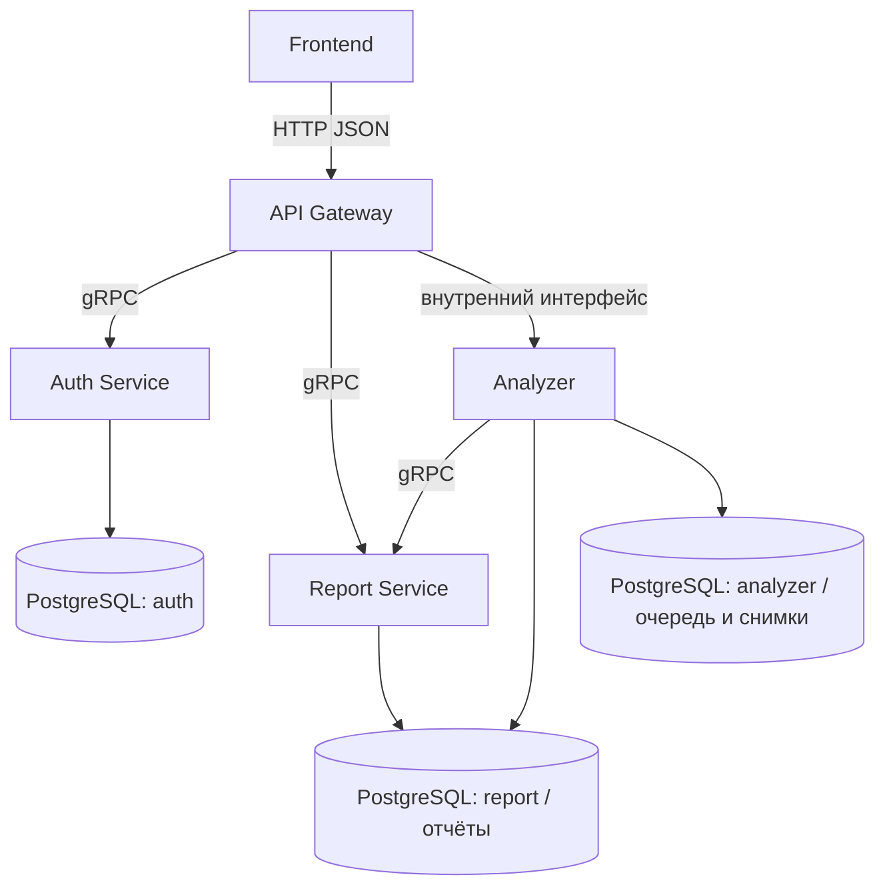

# Компоненты RepoPulse

Источник: [архитектура №916](https://ai.nsu.ru/documents/916).

Analyzer показан одним блоком на уровне сервисов. Сбор данных, анализаторы,
Score и объяснение — его внутренние модули; последовательность их работы описана
в [flow данных](../data-flow.md#выполнение-analyzer-и-сохранение).

Auth владеет идентичностями и сессиями. Analyzer фиксирует владельца, момент
оценки, данные и результат; атомарно берёт задания из очереди. Report читает
неизменяемые отчёты и историю с проверкой доступа. PostgreSQL одна; схема report
хранит отчёты, analyzer — снимки и очередь, auth — идентичности.
Контракты транспорта находятся в сервисных пакетах `contracts/`.
